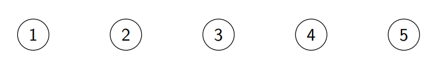
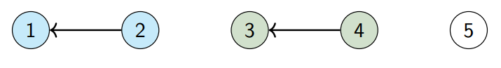
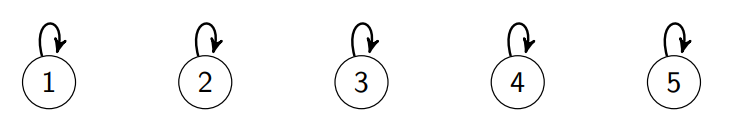
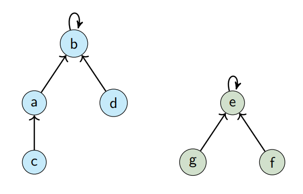
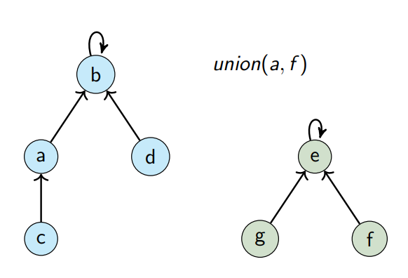
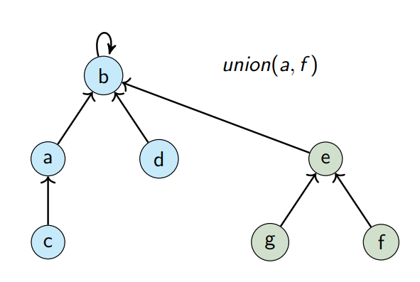
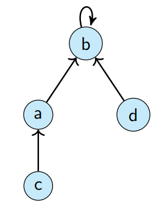
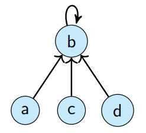

# Conjuntos Disjuntos (disjoint set)

A estrutura de dados disjoint set, também conhecido como union-find, é uma estrutura de dados utilizada para manter e
manipular conjuntos disjuntos (sem elementos em comum).
Sua principal finalidade é determinar rapidamente se dois elementos pertencem ao mesmo conjunto e unir conjuntos diferentes.

> Muito util para estrutura de gráficos!

O **disjoint set** suporta as seguintes operações:
- makeSet(x): Cria um novo conjunto {x}. x não deve estar em nenhum outro conjunto.
- union(x, y): Combina o conjunto que contém x com o conjunto que contém y.
- find(x): find(x) = find(y) se e somente se x e y estão no mesmo conjunto.

> Exemplo:



> union(1, 2) e union(3, 4)



## Representação utilizando Vetor

A implementação mais comum utiliza um vetor parent:

```
int[] parent = new int[n];
```

Cada posição representa um elemento. O valor armazenado indica o seu pai na estrutura. Inicialmente o elemento aponta para o seu próprio pai, isto ocorre pelo método makeSet:

```
void makeSet(int x) {
    parent[x] = x;
}
```

Quando parent[x] == x, significa que x é o representante (raiz) do conjunto.



## Operação find()

A operação find(x) percorre os pais até encontrar o representante do conjunto, isto é, a raiz da árvore.

```
int find(int x) {
    if (parent[x] == x) {
        return x;
    }
    return find(parent[x]);
}
```

## Operação union()

A operação union(x, y) une os conjuntos que contêm os elementos x e y.
Para isso:

1. Encontramos o representante de x.
2. Encontramos o representante de y.
3. Conectamos uma raiz `a outra.

> Observe a operação union, a seguir

```
void union(int x, int y) {
    x = find(x);
    y = find(y);
    parent[y] = x;
}
```

Esta operação é conhecida como Quick-union.







Observe que os conjuntos est˜ao se unindo e criando árvores.

1. O tempo por operação é proporcional ao tamanho da árvore.
2. No entanto, é possível, no pior caso, gerar uma estrutura linear de n nós.
3. Utilizar várias vezes a operação find em estrutura linear torna-se custoso.

## Melhorias

### Melhoria 1

Weighted Quick-Union
- Modifique o quick-union para evitar árvores altas.
- Mantenha uma variável para armazenar o tamanho da árvore (número de elementos).
- Ao realizar a operação de union, interligue a raiz da menor árvore na raiz da maior árvore.

> pega a menor árvore e junta com a maior

find e makeSet. Idêntico ao quick-union.

union. Modifique o quick-union para:
- Ligar a raiz da menor árvore para a raiz da maior árvore.
- Atualize o vetor size[].

```
void union(int x, int y) {
    x = find(x);
    y = find(y);
    if(x == y) return;
    if(size[x] < size[y]) {
        int temp = x;
        x = y;
        y = temp;
    }
    parent[y] = x;
    size[x] += size[y];
}
```

## Melhoria 2

Path compression
• ideia: atualizar os pais dos elementos visitados durante a busca, fazendo com que apontem diretamente para a raiz.
• objetivo: Reduzir a altura das árvores e tornar as próximas operações find mais rápidas.

Path compression

```
int find(int x) {
    if(parent[x] != x) 
        parent[x] = find(parent[x]);
    
    return parent[x];
}
```

> Tempo de execução: O(lg n) amortizado

---

> Exemplo: Path compression





(a) antes da compressão, (b) após a compressão.

```
void makeSet(int x) {
    parent[x] = x;
    size[x] = 1;
}
```

```
void union(int x, int y) {
    x = find(x);
    y = find(y);
    if (x == y) return;
    if (size[x] < size[y]) {
        int temp = x;
        x = y;
        y = temp;
    }
    parent[y] = x;
    size[x] += size[y];
}
```

```
int find(int x) {
    if (parent[x] != x)
    parent[x] = find(parent[x]);
    return parent[x];
}
```

```
boolean connected(int x, int y) {
    return find(x) == find(y);
}
```

```
int getSize(int x) {
    return size[find(x)];
}
```

Considerando m operações sobre conjuntos disjuntos
- Com Weighted Quick-Union e Path compression
- Tempo de execução: O(mα(n)), onde α(n) é a inversa da função de Ackerman (detalhes: Livro do Cormen - cap 21).

> Nota: Se n < 16^512 ≈ 10^616 então α(n) ≤ 4.
> Existem apenas 10^80 ´atomos no universo observável.

## Exercícios

1. Uma plataforma permite que usuários formem grupos de estudo. 
Inicialmente, cada usuário pertence a um grupo individual.
Implemente um programa que processe os seguintes comandos:

- UNION A B: une os grupos de A e B.
- SAME A B: verifica se A e B pertencem ao mesmo grupo (SIM ou NAO).
- SIZE A: informa a quantidade de usuários no grupo de A.

Entrada: N usuários e Q comandos, seguidos pelos comandos.

```
7 10
UNION 1 2
UNION 3 4
UNION 2 3
SAME 1 4
SAME 1 5
SIZE 2
UNION 5 6
SIZE 6
UNION 6 7
SIZE 1
```

Saída:

```
SIM
NAO
4
2
4
```

2. Um sistema de armazenamento permite agrupar arquivos em coleções. Inicialmente, cada arquivo pertence a uma coleção individual. O sistema permite unir coleções e verificar se dois arquivos pertencem à mesma coleção.
Implemente um programa que processe os seguintes comandos:
- MERGE A B: une as cole¸c˜oes que contêm os arquivos A e B.
- SAME A B: verifica se dois arquivos pertencem à mesma coleção (SIM ou NAO).
- COUNT A: informa quantos arquivos existem na coleção de A.

Entrada: N arquivos e Q comandos, seguidos pelos comandos.

```
10 11
MERGE 1 2
MERGE 3 4
MERGE 2 3
SAME 1 4
COUNT 2
MERGE 5 6
MERGE 7 8
MERGE 6 7
SAME 5 8
COUNT 7
COUNT 9
```

Saída:

```
SIM
4
SIM
4
1
```