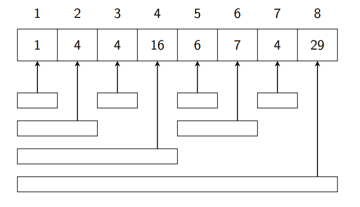
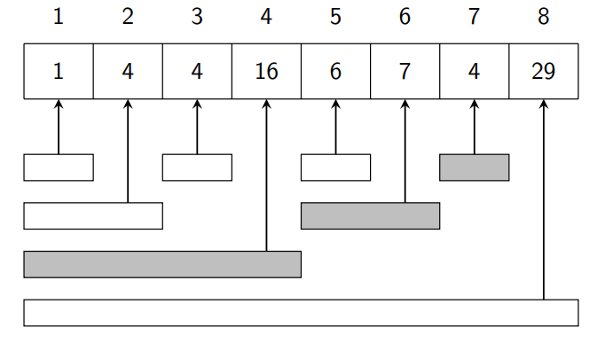
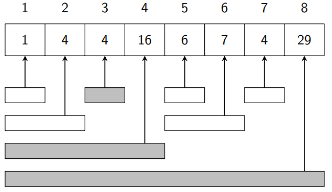
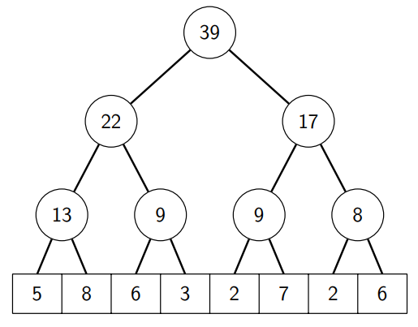

# Arvore de Fenwick

A árvore de Fenwick, também conhecida por **BIT (binary indexed tree)**, foi apresentada por P. M. Fenwick em 1994 como uma estrutura para facilitar consultas e atualizações em vetores.
Essa estrutura permite calcular somas de prefixos e atualizar valores de forma eficiente, sem precisar recalcular todas as somas a cada alteração.

## Estrutura 

Permite duas operações em tempo O(lg n):
- consulta de soma em intervalos; e
- atualizações de valores.

A árvore de Fenwick é uma árvore represenetada em um vetor iniciando no índice 1.

Seja p(k) o valor da maior potência de 2 que divide k.
Armazenamos uma árvore binária indexada como um vetor tal que:

```tree[k] = sum(k − p(k) + 1, k)```

cada posiçãao k contém somas de valores em um intervalo do vetor original cujo tamanho é p(k) e termina na posição k.

---

## Exemplo

Considere o seguinte vetor v:
| 1 | 2 | 3 | 4 | 5 | 6 | 7 | 8 |
|:---:|:---:|:---:|:---:|:---:|:---:|:---:|:---:|
| 1 | 3 | 8 | 4 | 6 | 1 | 3 | 2 |

A árvore binária indexada correspondente á a seguinte:
| 1 | 2 | 3 | 4 | 5 | 6 | 7 | 8 |
|:---:|:---:|:---:|:---:|:---:|:---:|:---:|:---:|
| 1 | 4 | 4 | 16 | 6 | 7 | 4 | 29 |

> Exemplo: p(6) = 2, tree[6] contém o valor de soma(5, 6).

---

A figura a seguir mostra como cada valor na árvore binária indexada corresponde ao intervalo no vetor original.



---

## Soma de valores no intervalo

Com a árvore binária indexada:
- O cálculo do valor de soma(1, k) pode ser executado em tempo O(lg n);
- O intervalo [1, k] pode ser sempre dividido em O(lg n) intervalos cujas somas estão na árvore.

---

Para o intervalo [1, 7] temos os intervalos:

   

> Podemos calcular o valor da soma(1, 7): 
> soma(1, 7) = soma(1, 4)+soma(5, 6)+soma(7, 7) = 16 + 4 + 6 = 27

---

Para calcular o valor da soma(a, b) onde a > 1, podemos usar o mesmo método usado em vetor de soma de prefixos. 

```soma(a, b) = soma(1, b) − soma(1, a − 1)```

O tempo de execução é O(lg n).

---

### Atualização do vetor original

Quando o vetor original é atualizado, temos que realiza a atualização da árvore binária indexada.

> Exemplo: Ao alterar a posição 3, temos que alterar as seguintes posições.



---

## Implementação

As operações de uma árvore binária indexada (binary indexed tree) podem ser implementadas usando operaçõoes de bits. Contudo, podemos calcular o valor de p(k) usando a fórmula:

```p(k) = k& − k.```

Esta operação é um truque de manipulação de bits que serve para isolar o bit menos significativo (Least Significant Bit, ou LSB). O resultando é uma potência de 2 que divide k.

### Cálculo da soma no intervalo

O trecho de código a seguir calcula o valor da soma(1, k).
```
int soma(int k) {
    int s = 0;
    while (K >= 1){
        s += tree[k];
        k -= k&-k;
    }
    return s;
}
```
> Consumo de tempo: O(lg n)

---

### Atualização de um valor no intervalo

A seguinte função aumenta o valor do vetor na posição k por x (x pode ser positivo ou negativo).
```
void aumenta(int k, int x) {
    int s = 0;
    while (K <= n){
        tree[k] += x;
        k += k&-k;
    }
}
```
> Consumo de tempo: O(lg n)

---

# Arvore de Segmentos

Uma árvore de segmentos é uma estrutura de dados que suporta duas operações:
- processamento de consultas em intervalos (soma, mínimo, máximo e outros);
- atualiza¸c˜ao de valores no intervalo.

Comparado com a árvore de Fenwick, a árvore de segmentos é uma estrutura de dados mais geral.

---

## Exemplo

Como exemplo, assuma um vetor abaixo de tamanho potência de 2 e com o primeiro índice em zero.

| 0 | 1 | 2 | 3 | 4 | 5 | 6 | 7 |
|:---:|:---:|:---:|:---:|:---:|:---:|:---:|:---:|
| 5 | 8 | 6 | 3 | 2 | 7 | 2 | 6 |

Vamos construir a árvore de segmentos usando o operador de soma.



Cada nó interno corresponde a um intervalo de tamanho potência de 2, e pode ser calculado como a soma de valores dos nós da esquerda e da direita.

Perceba que qualquer intervalo [a, b] pode ser decomposto em O(lg n) intervalos cujos valores ficam armazenados nos nós da árvore.

---

## Implementação

A função a seguir constrói a árvore de segmentos.
```
void constroi(int []v, int []tree) {
  for(int i = 0; i < n; i++)
    tree[i+n] = v[i];

  for(int i = n-1; i >= 1; i--)
    tree[i] = tree[2*i] + tree[2*i+1];
}
```
> Consumo de tempo: O(n)

A função a seguir calcula o valor de soma no intervalo [a, b].
```
int soma(int a, int b) {
  a += n; b += n;
  int s = 0;
  while (a <= b){
    if (a%2 == 1) s += tree[a++];
    if (b%2 == 0) s += tree[b--];
    a/=2; b/=2;
  }
  return s;
}
```
> Consumo de tempo: O(lg n)